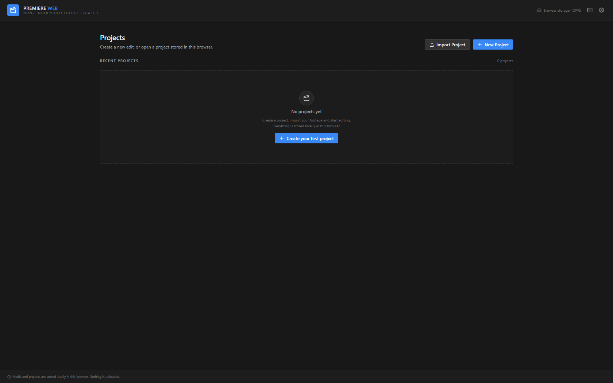
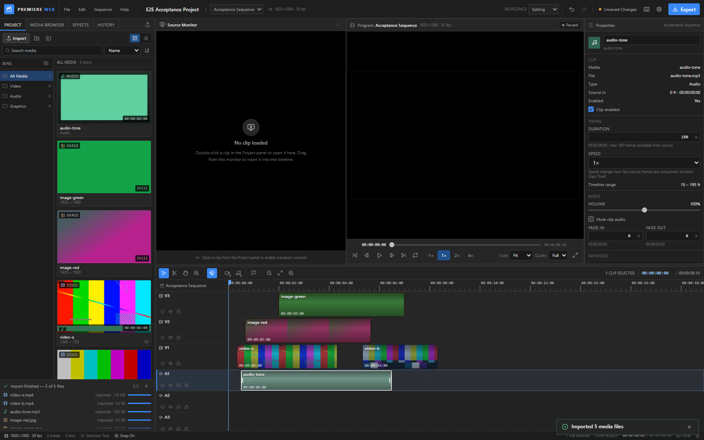
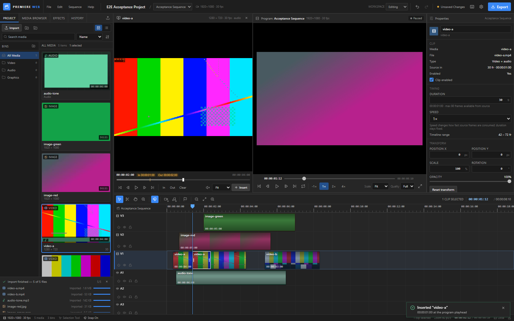
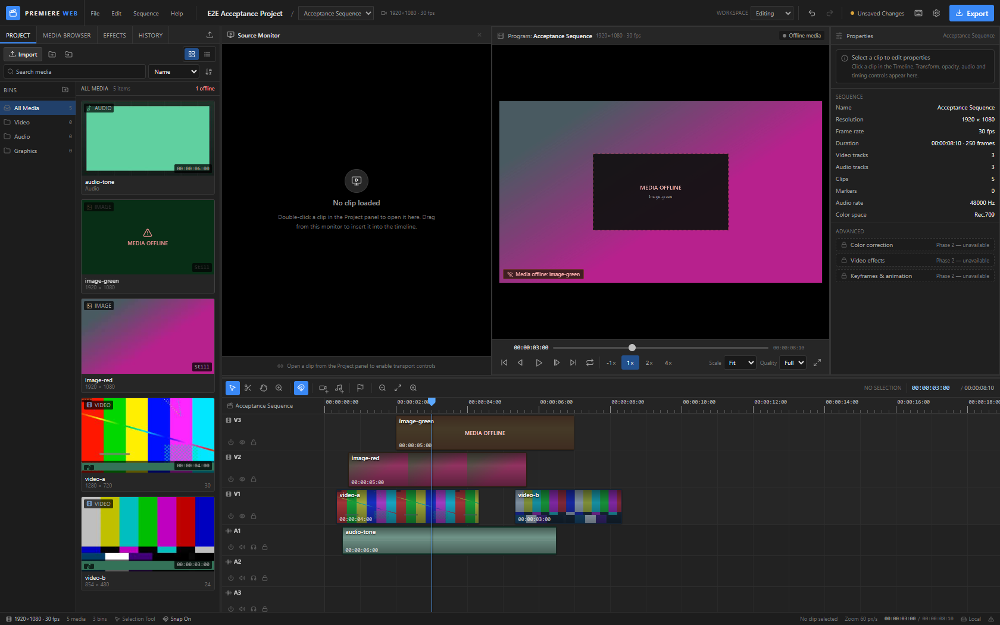
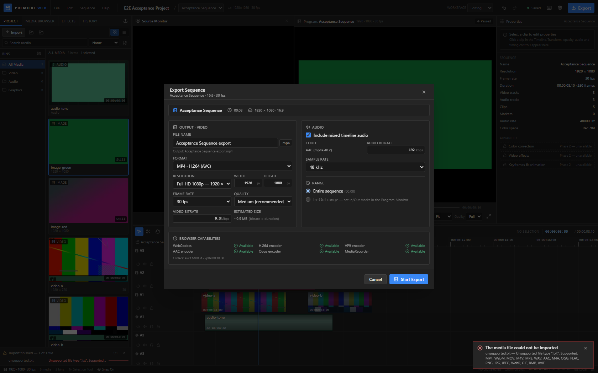
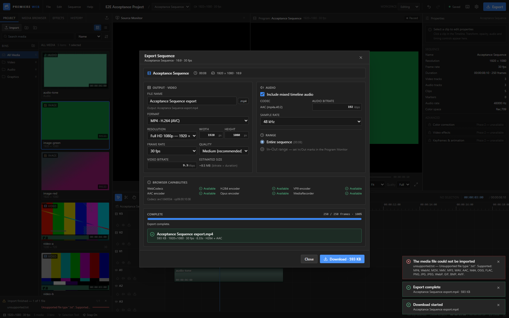

# Premiere Web — Browser Non-Linear Video Editor (Phase 1)

A functional, browser-based non-linear video editor inspired by Adobe Premiere Pro.
Phase 1 delivers a complete editing foundation: project management, media import,
source/program monitors, a multitrack timeline with frame-accurate editing,
synchronized playback, local persistence, and real WebCodecs video export.

> **Not a mockup.** Every button in the workspace is wired to real editing logic.
> Video previews are composed from the actual timeline; export re-renders and
> encodes the sequence rather than downloading a source file.

---

## 1. Feature overview

### Project management
- Project home with recent projects, generated thumbnails, resolution, frame rate,
  media count and last-modified date.
- New Project dialog: name, sequence name, resolution presets (720p/1080p/1440p/4K/custom),
  aspect ratio (16:9, 9:16, 1:1, 4:3, custom), frame rates (23.976–60), audio sample rate,
  color space and preview quality.
- Duplicate, delete, export project file (.json) and import project file.
- Debounced autosave plus manual save with clear status: Saved / Saving / Unsaved Changes / Save Failed.
- Versioned project schema with validation and normalisation on load.
- Multiple sequences per project (create/switch via the Sequence menu or the sequence selector).

### Media management
- Import multiple files, folders, or drag-and-drop onto the Media panel.
- Metadata probing: duration, dimensions, frame rate, audio presence, file size, MIME type.
- Generated video/image thumbnails and audio waveform peaks.
- Bins: create, rename, delete, move media between bins.
- Search, sort, thumbnail/list views, missing-media indicators and a relink workflow.
- Media persisted to OPFS (preferred) or IndexedDB with object URLs recreated on open.
- Effects tab intentionally reserved for Phase 2 (clearly labelled, no fake controls).

### Source Monitor
- Real preview of imported video, audio and images.
- Seek, frame-step, play/pause, in/out marks with marked-range display, mute, preview scale.
- Insert marked range (or whole clip) into the timeline at the playhead.
- Drag directly from the Source Monitor/Media panel to the timeline.

### Program Monitor
- Live composite of the active sequence: V1 at the bottom, higher video tracks above,
  images, transforms (position/scale/rotation/opacity), gaps rendered black.
- Performance-clock playback (not React render rate) synchronized to the timeline playhead.
- Audio from video and audio clips, with clip gain, track mute/solo and fade envelopes.
- Frame stepping, seek, J/K/L rates, loop, jump to start/end, fit/25/50/100/200% scaling,
  fullscreen, and preview-quality selector.
- Missing media and decode failures surface as non-fatal overlays.

### Timeline
- Multitrack editing with unlimited video/audio tracks (V1…, A1…), add/delete/reorder.
- Track headers: lock, mute, solo, hide, enable, rename, height adjustment (drag or presets).
- Clips: frame-accurate placement, drag/move between tracks, multi-select, ripple-free moves,
  trim in/out, razor split, duplicate, copy/cut/paste, delete, enable/disable, playback speed.
- Visual clip strips with thumbnails, audio waveforms, selection borders, trim handles,
  fade overlays, duration labels and source identification.
- Selection, Razor, Hand and Zoom tools; snapping to clip edges, playhead, markers and sequence start.
- Adaptive time ruler, frame-accurate timecode, zoom around pointer, wheel scroll, auto-scroll
  during playback.
- Context menus for clips, tracks and empty timeline areas.
- Full undo/redo history (operation-labelled), restored per project session.

### Properties panel
- Contextual video/image properties: duration, position, scale, rotation, opacity, enabled, speed.
- Audio properties: gain, mute, fade in/out (frames and timecode), duration, speed.
- Multi-selection summary actions; sequence overview when nothing is selected.
- Advanced Phase 2 groups (color/effects/keyframes) labelled as unavailable.

### Export
- Renders the edited sequence frame-by-frame (tracks, trims, transforms, gaps) on a canvas.
- WebCodecs H.264 video + AAC audio muxed into MP4 with `mp4-muxer` (VP9/Opus fallbacks
  where supported; MediaRecorder WebM fallback when WebCodecs is unavailable).
- Real progress from processed frames, cancellation, capability detection, output download.
- Audio mixed offline with trims, gain and fades using the Web Audio API.

### Platform
- Central keyboard shortcut manager that ignores editable fields and open dialogs.
- Toast notifications, confirmation dialogs, error boundary, browser capability warnings.
- Custom workspace layouts (Editing / Assembly / Audio) and resizable panels.
- Responsive, compact dark graphite UI in the spirit of Premiere Pro.

---

## 2. Screenshots

| Project home | Editing workspace |
| --- | --- |
|  |  |

| Source Monitor with In/Out marks | Missing media + relink |
| --- | --- |
|  |  |

| Export dialog with capability detection | Real MP4 export complete |
| --- | --- |
|  |  |

---

## 3. Tech stack

| Area | Choice |
| --- | --- |
| UI | React 18 + TypeScript |
| Build | Vite |
| Styling | Tailwind CSS + CSS variables |
| Icons | lucide-react |
| State | Zustand stores (project, media, timeline, playback, workspace) |
| Timeline engine | Pure TypeScript, integer-frame editing model |
| Playback | HTMLMediaElement decoding + Canvas 2D compositing + Web Audio API |
| Storage | IndexedDB (projects, fallback media blobs) + OPFS (large media) |
| Export | WebCodecs `VideoEncoder`/`AudioEncoder` + `mp4-muxer`; MediaRecorder fallback |
| Tests | Vitest (unit) + Playwright (end-to-end) |

---

## 4. Getting started

Requires Node.js 18+ and a Chromium-based browser (Chrome/Edge recommended).

```bash
npm install
npm run dev          # http://127.0.0.1:5173
```

Production build:

```bash
npm run build
npm run preview
```

Type-check, unit tests and end-to-end tests:

```bash
npm run typecheck
npm run test
npm run e2e               # requires the dev server + Chrome + sample media
npm run e2e:project-file  # portable project file export/import test
```

The E2E scripts launch the local Chrome installation (default
`C:\Program Files\Google\Chrome\Application\chrome.exe`; override with the
`CHROME_PATH` environment variable, or set `HEADED=1` to watch the test). They expect
`npm run dev` to be running on `http://127.0.0.1:5173` (override with `APP_URL`).

### Sample media for testing

`test-media/` contains small generated files used by the E2E suite. To regenerate
them you need ffmpeg:

```bash
ffmpeg -f lavfi -i "testsrc2=size=1280x720:rate=30" -f lavfi -i "sine=frequency=440" \
  -t 4 -c:v libx264 -pix_fmt yuv420p -c:a aac -shortest test-media/video-a.mp4
# ...see scripts/e2e.mjs for the full list
```

The E2E suite drives real Chrome via Playwright, creates a project, imports media,
edits the timeline, plays it back, saves, reloads, reopens and exports a real MP4.
A separate `e2e:project-file` script verifies portable project-file export/import.
Run `HEADED=1 npm run e2e` to watch it.

---

## 5. Workflow walkthrough

1. **Open the app** → **New Project** → choose a name, 1080p, 30 fps → **Create Project**.
2. **Import Media** (or drop files onto the Media panel). Thumbnails and metadata appear.
3. Drag a video onto **V1**, another onto **V2**, an audio file onto **A1**.
4. Use the **Selection** tool to move/trim clips; press **C** for the Razor tool or **Ctrl+K**
   to split at the playhead.
5. Press **Space** to play the sequence; watch the Program Monitor composite update with audio.
6. Select clips and adjust **Position / Scale / Opacity / Gain / Fades** in Properties.
7. Press **Ctrl+S** (autosave also runs) and **Export** → choose settings → **Start Export** →
   **Download** the MP4.
8. Reload the browser, open the project from the home screen and continue editing.

---

## 6. Architecture

```
src/
  app/            App shell, error boundary, dev debug hook
  components/     Shared UI primitives, dialogs, context menus, notifications
  features/
    project-manager/  Project home + new project dialog
    workspace/        Editor shell, top bar, status bar, layout resizing
    media-library/    Media panel (Project/Media Browser/Effects/History) + import UI
    source-monitor/   Source preview + in/out marks + insert
    program-monitor/  Composite preview + transport controls
    properties/       Contextual clip/sequence properties
    timeline/         Multitrack timeline UI and interactions
    export/           Export dialog and progress UI
  engine/
    timeline/       Data model factories + pure editing operations
    playback/       Program playback engine, media element cache, registry
    compositor/     Frame compositing helpers
    audio/          Audio graph helpers
    exporter/       Renderer, WebCodecs encoder, muxing, fallback recorder
  stores/          Zustand state (project, media, timeline, playback, workspace)
  services/        Import, thumbnail probing, storage, project files, autosave, export
  utils/           Frame math, timecode, render/audio helpers, geometry, presets
  types/           Shared domain types
scripts/e2e.mjs    Playwright acceptance suite
```

### Authoritative timing model

All timeline positions and durations are **integer sequence frames**. A sequence
stores its frame rate as an exact rational `{ num, den }` (e.g. 30000/1001).
Seconds are only produced at browser API boundaries (media elements, audio
contexts, WebCodecs timestamps), using exact rational conversion. This prevents
floating-point drift and guarantees frame-accurate edits and timecode.

- `frame = round(seconds × num / den)`
- `seconds = frame × den / num`
- Timecode is SMPTE with drop-frame support for 29.97/59.94.

### Undo/redo

The project store keeps labelled snapshots of the last 120 operations. Drags use
`beginEdit()` → `liveEdit()` → `endEdit()` so one pointer gesture produces one
undo step. Media blobs live outside the project document, so undo/redo never
duplicates media or corrupts references.

### Persistence model

- Project documents (`Project` JSON: media metadata, bins, sequences, tracks,
  clips, markers, workspace) → IndexedDB `projects` store.
- Media blobs → OPFS `media/` directory where available, else IndexedDB `media`.
- Object URLs are created on open and revoked on close; they are never persisted.
- Autosave is debounced (1.5 s) and flushed when the tab is hidden.
- Missing media is detected on open and can be relinked without losing edit data.

---

## 7. Keyboard shortcuts

| Shortcut | Action |
| --- | --- |
| Space | Play/Pause |
| J / K / L | Reverse play / Pause / Forward play (repeat for 2×, 4×) |
| ← / → | Previous / next frame |
| Home / End | Sequence start / end |
| V / C / H / Z | Selection / Razor / Hand / Zoom tool |
| Ctrl+Z / Ctrl+Shift+Z | Undo / Redo |
| Ctrl+S | Save project |
| Ctrl+C / Ctrl+V / Ctrl+X | Copy / Paste / Cut clips |
| Delete / Backspace | Delete selected clips |
| Ctrl+A | Select all clips |
| Ctrl+K / Ctrl+Shift+K | Split selected / all clips at playhead |
| Ctrl+D | Duplicate selected clips |
| Alt+← / Alt+→ | Nudge selected clips one frame |
| + / − | Zoom in / out |
| \ | Zoom to fit sequence |
| M | Add marker at playhead |
| Ctrl+E | Open Export dialog |

Shortcuts are disabled while typing in inputs, selects, or content-editable fields,
and while a modal dialog is open.

---

## 8. Supported browsers and media formats

### Browsers

| Browser | Status |
| --- | --- |
| Chrome / Edge 94+ (desktop) | Recommended. Full editing; H.264/AAC MP4 export when WebCodecs codecs are available. |
| Opera / Brave (Chromium 94+) | Supported similarly to Chrome, subject to codec availability. |
| Firefox 130+ | Editing and playback supported for browser-decodable media. WebCodecs support varies; export may fall back to WebM/MediaRecorder or report unavailable codecs. |
| Safari 17+ | Basic editing may work; OPFS/WebCodecs/MediaRecorder support and codec availability vary by version. Not the primary target. |

The app detects and reports unavailable capabilities on the project home screen and
in Settings. Feature-specific errors are shown as notifications instead of crashing.

### Media formats

- **Video:** MP4, M4V, WebM, MOV (container support depends on the browser's codecs),
  OGV. H.264/AAC in MP4 is the most reliable combination in Chromium.
- **Audio:** MP3, WAV, AAC/M4A, OGG, Opus, FLAC (browser dependent).
- **Images:** PNG, JPEG, WebP, GIF, BMP, AVIF (browser dependent).
- **Export:** MP4 (H.264 + AAC) preferred; MP4 (VP9/Opus) or WebM fallback when the
  required encoders are unavailable.

---

## 9. Testing

```bash
npm run test      # 61 unit tests: frame math/timecode, timeline ops, compositor, playback clock, import pipeline, schema, persistence
npm run e2e       # full browser acceptance test (see prerequisites)
```

Unit tests cover:
- rational frame/timecode conversion incl. drop-frame,
- clip move/split/trim/duplicate/delete, linked references, track operations,
- compositor track order, hidden/disabled clips, offline slates,
- playback clock math, import validation/probing helpers, source transport,
- project schema validation/normalisation and project duplication,
- IndexedDB save/load/duplicate/delete round-trips with `fake-indexeddb`.

The Playwright suite verifies project creation, multi-file import with metadata and
thumbnails, drag-and-drop to tracks, move/trim/split/delete + undo/redo, track
creation, playback and frame stepping, Source Monitor in/out marks and range insert,
live Properties changes affecting the composite, copy/paste, save → reload → reopen
state equality, missing-media overlay + relink, unsupported-file errors, export
cancellation, and a real export download (independently verified with ffprobe as
H.264 1920×1080 30 fps + AAC 48 kHz stereo MP4).

---

## 10. Known limitations (Phase 1)

- **No transitions, effects, keyframes, color grading, motion graphics or audio mixing
  console.** These are reserved for later phases and labelled as unavailable in the UI.
- **Codec coverage is browser-dependent.** MOV/ProRes/HEVC files only play if the
  browser can decode them. Unsupported files are rejected with a clear message.
- **Export is not hardware-accelerated beyond what the browser provides.** WebCodecs may
  use software encoding; large 4K exports can be slow and memory-intensive.
- **MP4 muxing holds the encoded output in memory** (`fastStart: 'in-memory'`), so very
  long/4K exports are limited by available browser memory.
- **Frame-accurate export for variable-frame-rate sources** uses per-frame seeking; VFR
  sources are sampled at the sequence frame rate. Export speed depends on how fast the
  browser can seek each source element.
- **In–Out export range** is supported by the export engine, but the Phase 1 dialog only
  offers "Entire sequence" because the Program Monitor does not expose program in/out
  marks yet.
- **Reverse playback** is frame-stepped (audio is muted in reverse because browsers cannot
  play media backwards).
- **Autoplay restrictions**: if the browser blocks audible playback, the engine continues
  in silent mode and shows an "Enable audio" prompt.
- **Audio gain above 100%** requires Web Audio; the element-volume fallback caps at 100%.
- **Audio mixing** is per-clip gain/fades and track mute/solo in Phase 1. There is no
  submix, EQ, compressor or panning yet; playback-rate changes also shift audio pitch.
- **Audio waveform peaks** are generated for natively decodable audio. Video-with-audio
  clips display a thumbnail strip rather than a waveform; very large files skip the
  optional waveform analysis, and some codecs may not expose audio to `decodeAudioData`.
- **Native FPS / has-audio detection for imported video is best-effort** (requestVideoFrameCallback
  sampling and browser heuristics); the sequence frame rate is always authoritative.
- **Clip speed** changes how fast source frames are consumed while the timeline duration
  stays fixed, so a clip can run out of source if sped up excessively.
- **Multi-select drags stay on their tracks**; only a single clip (or linked pair) can be
  dragged vertically to another track. Marquee selection does not auto-scroll at edges.
- **Track deletion** is limited to empty tracks, and at least one video/audio track must
  remain (a toast explains why).
- **Waveform display in the timeline** is shown for audio-kind clips; hidden/muted track
  and clip styling is reflected.
- **Source Monitor zoom** of 50%/100% crops around the centre; there is no source pan tool.
- **Folder import flattens the folder tree** into the current bin and silently skips
  non-media files.
- **Relinking** preserves the media id and updates the project, but a superseded blob whose
  file extension changed may remain as an orphaned OPFS file (orphan cleanup covers the
  IndexedDB fallback store).
- **Playback of overlapping video tracks** composites Canvas 2D at the sequence resolution
  (downscaled by the preview-quality selector); there is no GPU/WebGL pipeline yet.
- **Media is local to the browser profile.** Projects do not sync across devices; clearing
  site data deletes projects and media. Export a project file to move edit metadata.
- **Project-file import** carries metadata/edit state, not media blobs; media must be relinked.
- **Browser storage quotas** apply. Very large media libraries may exhaust quota; import
  errors are reported.
- **No collaboration, cloud storage or accounts.** Everything stays local.
- **Sequence settings** are fixed at creation in Phase 1 (create a new sequence with
  different settings instead of changing an existing one). Multiple sequences share the
  same editing workspace.
- **Proxy workflow** (transcoding heavy media to proxies) is not implemented.
- **WebM fallback export** is realtime and may drop/duplicate frames; it is reported as a
  fallback. VP9-in-MP4 and Opus-in-MP4 output has limited compatibility outside Chromium.
- **Audio duration in exports can be tens of milliseconds longer than video** due to AAC
  frame boundaries (typically ~10–25 ms).

---

## 11. Troubleshooting

| Symptom | Solution |
| --- | --- |
| "H.264 encoder unavailable" during export | Use Chrome/Edge with hardware/software H.264 support, or export VP9/WebM instead. |
| Playback button does nothing / "autoplay blocked" | Browsers block audible autoplay before a user gesture; click in the page, then press Space/Play again. |
| Media shows as offline | Use **Relink** in the Media panel context menu and choose the source file again. |
| Save Failed | Check available browser storage (Settings shows usage) and that IndexedDB is enabled (not private-mode-restricted). |
| Timeline drop does nothing | Drop onto a compatible track (video/image → video track, audio → audio track) and make sure the track is not locked. |
| Export cancelled or fails | Check capability warnings in the Export dialog; try a lower resolution or the WebM fallback. |
| UI looks cramped | Use the workspace selector or drag the panel splitters; Settings → Reset panel layout. |

---

## 12. Disclaimer

This project is an independent educational clone inspired by Adobe Premiere Pro's
interface. It is not affiliated with or endorsed by Adobe. "Premiere" and "Adobe"
are trademarks of Adobe Inc.
